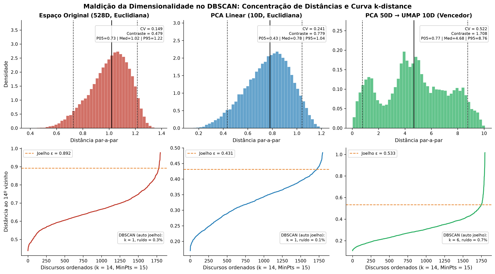
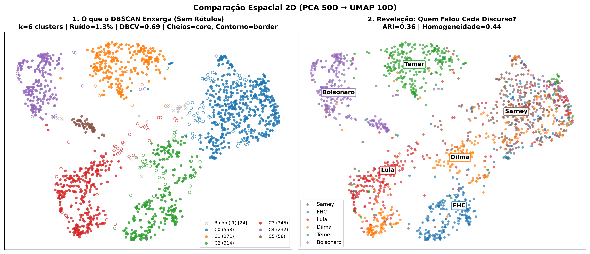
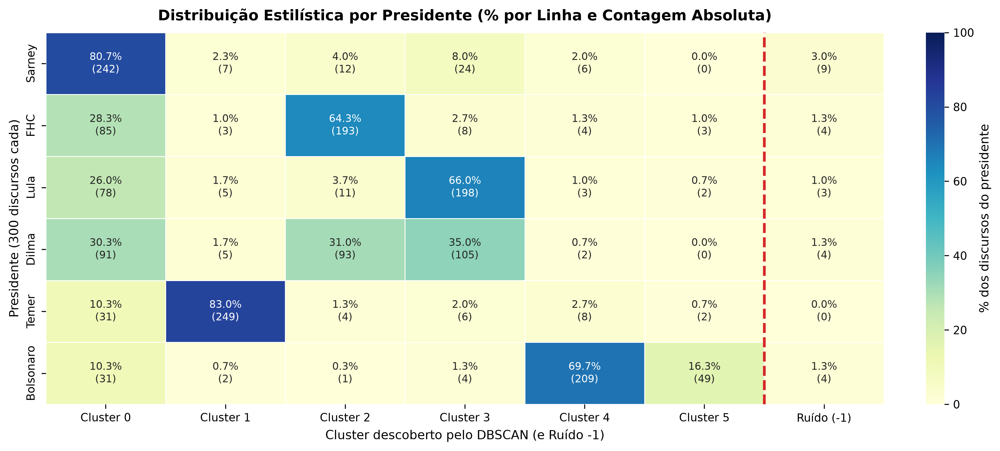
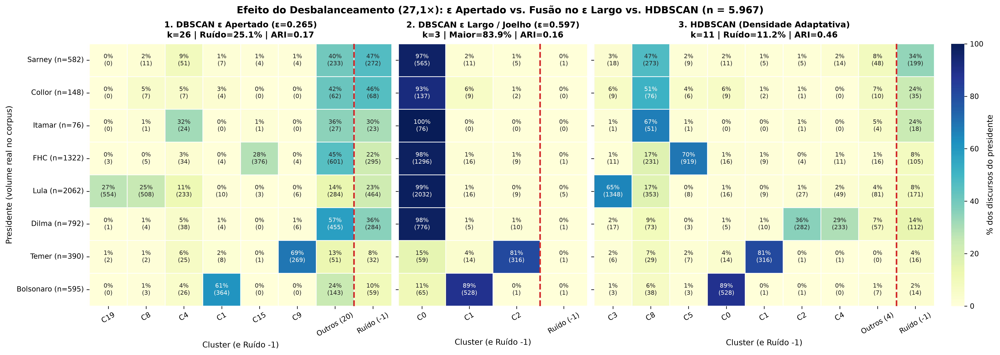

# Clustering de Estilo Discursivo dos Presidentes do Brasil (1985–2022) com DBSCAN e Redução de Dimensionalidade

Análise não supervisionada de **estilo discursivo** nos pronunciamentos oficiais dos presidentes da Nova República utilizando **DBSCAN** (*Density-Based Spatial Clustering of Applications with Noise*) sobre atributos puramente estilométricos, investigando como diferentes métodos de **redução de dimensionalidade** alteram a geometria e a qualidade dos agrupamentos baseados em densidade.

- **Corpus principal (balanceado):** `1.800` discursos (`300 × 6` presidentes: Sarney, FHC, Lula, Dilma, Temer e Bolsonaro), filtrados de `6.069` arquivos originais (`5.967` limpos após remoção de entrevistas Q&A, textos `< 120` palavras, não-PT e duplicatas).
- **Atributos puramente estilísticos (`p = 528`):** `23` métricas estilométricas (extensão de frases/palavras, `MTLD`, `MATTR-100`, `Flesch-PT`, 1ª pessoa, pontuação, oralidade, conectivos cultos, sufixos morfológicos), `255` palavras funcionais de classe fechada e `250` *char_wb* 3–4-grams — **sem nomes de presidentes, anos ou vocabulário temático**.
- **Experimento complementar (desbalanceado):** `5.967` discursos completos dos 8 presidentes (razão `27,1×` entre Lula `2.062` e Itamar `76`), contrastando o dilema do $\varepsilon$ global no DBSCAN com o HDBSCAN.

---

## Comparação de Reduções de Dimensionalidade (`n = 1.800`)

Todos os cenários foram ajustados de forma estritamente não supervisionada (máximo **DBCV** com `k ≥ 2` clusters e `1% ≤ ruído ≤ 45%`, ou joelho *k-distance* em `MinPts = 15`), sem consultar os rótulos dos presidentes:

| Cenário | Dim | CV dist. | MinPts / $\varepsilon$ | Clusters ($k$) | Ruído (%) | DBCV | Silhouette (s/ ruído) | ARI | Homog. |
| :--- | :---: | :---: | :---: | :---: | :---: | :---: | :---: | :---: | :---: |
| `01_orig_euclid` (Original Euclidiana) | 528 | 0,149 | 30 / 0,6367 | 2 | 40,7% | -0,0728 | 0,2553 | 0,0526 | 0,0683 |
| `02_orig_cosine` (Original Cosseno) | 528 | 0,281 | 30 / 0,2061 | 3 | 37,1% | -0,0849 | 0,2399 | 0,0556 | 0,0814 |
| `03_pca_2d` (PCA Linear 2D) | 2 | 0,500 | 30 / 0,0664 | 2 | 24,7% | 0,1618 | 0,5801 | 0,0459 | 0,0533 |
| `04_pca_10d` (PCA Linear 10D) | 10 | 0,241 | 10 / 0,2932 | 4 | 33,9% | -0,0860 | 0,2084 | 0,0679 | 0,0928 |
| `05_svd_10d` (Truncated SVD 10D) | 10 | 0,249 | 10 / 0,2789 | 4 | 34,2% | -0,0726 | 0,1793 | 0,0643 | 0,0965 |
| `06_umap_10d_md0` (UMAP `min_dist=0,0`) | 10 | 0,534 | 10 / 0,3473 | 10 | 4,2% | 0,6063 | 0,5784 | 0,3678 | 0,4845 |
| `07_umap_10d_md05` (UMAP `min_dist=0,5`) | 10 | 0,403 | 20 / 0,6942 | 17 | 43,2% | 0,1379 | 0,4374 | 0,1294 | 0,4181 |
| **`08_pca50_umap10` (PCA 50D → UMAP 10D)** | **10** | **0,522** | **30 / 0,5917** | **6** | **1,3%** | **0,6887** | **0,6505** | **0,3610** | **0,4351** |
| `09_tsne_perp10` (t-SNE `perplexity=10`) | 2 | 0,477 | 30 / 5,3167 | 15 | 40,1% | 0,1745 | 0,5672 | 0,1290 | 0,4029 |
| `10_tsne_perp50` (t-SNE `perplexity=50`) | 2 | 0,525 | 20 / 1,8053 | 15 | 37,6% | 0,1641 | 0,5677 | 0,1375 | 0,4221 |
| `11_stylo23_pca10` (Só 23 métricas → PCA 10D) | 10 | 0,340 | 10 / 1,9688 | 2 | 42,5% | -0,1127 | 0,2050 | 0,0258 | 0,0357 |
| `12_tfidf3000_svd50_umap10` (+Vocabulário 3000D) | 10 | 0,607 | 20 / 0,6776 | 7 | 1,7% | 0,8524 | 0,7723 | 0,6139 | 0,7080 |
| `13_kmeans_on_best` (K-Means `K=6` em PCA50→UMAP10) | 10 | 0,522 | — | 6 | 0,0% | 0,3531 | 0,6329 | 0,3550 | 0,4248 |

- **Alta dimensão (`528D`) e projeções lineares (`PCA 10D`, `SVD 10D`):** sofrem concentração de distâncias e pontes de densidade, colapsando em `k = 1` no joelho automático e atingindo $\text{DBCV} < 0$ na grade.
- **Vencedor (`PCA 50D → UMAP 10D`, `min_dist = 0,0`):** produz **`k = 6` clusters** (`1.624` *core points*, `152` *border points* e `24` ruídos = `1,33%`), com **$\text{DBCV} = 0{,}6887$**, **$\text{Silhouette (s/ ruído)} = 0{,}6505$**, **$\text{ARI} = 0{,}3610$** e estabilidade consistente em 10 sementes do UMAP ($\text{ARI} = 0{,}3655 \pm 0{,}0095$).





---

## Interpretação Básica dos Clusters

Ao cruzar os `6` grupos descobertos pelo DBSCAN com os presidentes reais, o modelo separa um **registro institucional compartilhado do cargo** das **assinaturas estilísticas individuais**:

- **C0 — Protocolar do Planalto (`n = 558`):** estilo formal e impessoal transversal a todos os mandatos (`80,7%` de Sarney, `26%–30%` dos discursos solenes de FHC, Lula e Dilma, e `10,3%` de Temer e Bolsonaro), caracterizado por palavras longas (`+1,14σ`), nominalizações (`+1,09σ`) e baixíssima oralidade (`-1,04σ`).
- **C1 — Retórica Jurídico-Oral (`Temer: 83,0%`):** uso acentuado de conectivos cultos (`+1,20σ`, ex.: *portanto*, *aliás*), advérbios em `-mente` (`+1,10σ`) e 1ª pessoa do singular.
- **C2 — Analítico / Expositivo (`FHC: 64,3%` e `Dilma: 31,0%`):** forte emprego de ponto e vírgula `;` (`+1,11σ`) e construção sintática estruturada.
- **C3 — Oralidade Narrativa (`Lula: 66,0%` e `Dilma: 35,0%`):** alta oralidade (`+1,00σ`), presença marcada de 1ª pessoa do singular (`+0,79σ`) e menor diversidade lexical `MTLD` (`-1,12σ`) ligada a repetições enfáticas.
- **C4 (`69,7%`) e C5 (`16,3%`) — Sub-estilos de Bolsonaro:** ambos com alta legibilidade (`Flesch-PT` elevado), divididos entre falas curtas e coloquiais (**C4**) e transcrições contínuas pouco pontuadas com média de `35,7` palavras por frase (**C5**).
- **Dilma Rousseff em três terços:** distribui-se equilibradamente entre o registro protocolar (**`30,3%` C0**), o técnico-expositivo com FHC (**`31,0%` C2**) e o de palanque/oralidade com Lula (**`35,0%` C3**).
- **Ruído (`-1`, `n = 24` / `1,33%`):** discursos estilisticamente híbridos/atípicos e resquícios pontuais de OCR isolados automaticamente como outliers.



---

## Corpus Completo Desbalanceado (`n = 5.967`) e HDBSCAN

Quando aplicamos o mesmo pipeline sem balanceamento sobre todos os `5.967` discursos (`8` presidentes, razão **`27,1×`** entre Lula `2.062` e Itamar `76`), a distância mediana ao 30º vizinho (`k30_dist`) varia **>56%** entre os presidentes, expondo o limite do $\varepsilon$ global no DBSCAN:

- **$\varepsilon$ apertado (`0,2646`):** preserva sub-núcleos, mas descarta `46,7%` de Sarney e `45,9%` de Collor como ruído (`k = 26`, $\text{ARI} = 0{,}1713$).
- **$\varepsilon$ largo / joelho (`0,5969`):** desencadeia *chaining* e funde **`83,9%` do corpus (`5.006` discursos)** em um único megacluster ($\text{ARI} = 0{,}1581$, $\text{Silhouette} = 0{,}0847$).
- **HDBSCAN (`min_cluster_size = 30, min_samples = 15`):** adapta o critério de densidade localmente e atinge **$\text{ARI} = 0{,}4587$** ($\text{Homogeneidade} = 0{,}5327$), recuperando tanto grupos densos quanto minorias esparsas.



---

## Estrutura do Projeto

```text
.
├── README.md
├── requirements.txt
├── src/
│   ├── 01_download_data.py                  # Download e inventário do corpus Kaggle
│   ├── 02_preprocess_and_features.py        # Limpeza textual, remoção de vazamentos e matriz 528D
│   ├── 03_run_experiments.py                # Grade de 13 cenários, estabilidade e perfis
│   ├── 04_generate_figures.py                # Geração das figuras fig01..fig09 (300 DPI)
│   └── 05_unbalanced_density_experiment.py  # Corpus completo (n=5.967), DBSCAN vs HDBSCAN (fig10..fig11)
├── data/processed/                          # Tabelas CSV e metadados JSON dos resultados
└── outputs/figures/                         # 11 figuras (fig01..fig11)
```

---

## Como Reproduzir

```bash
python -m venv .venv
source .venv/bin/activate
pip install -r requirements.txt

python src/01_download_data.py
python src/02_preprocess_and_features.py
python src/03_run_experiments.py
python src/04_generate_figures.py
python src/05_unbalanced_density_experiment.py
```

---

## Fonte dos Dados

- **Dataset:** *Discursos presidentes civis do Brasil - 1985-2022* (Gonçalves, Meira & Gondim, UFPB)
- **Kaggle:** `pascoalgoncalves/discursos-presidentes-civis-do-brasil-1985-2022` — DOI: [`10.34740/KAGGLE/DS/5566939`](https://doi.org/10.34740/KAGGLE/DS/5566939)
